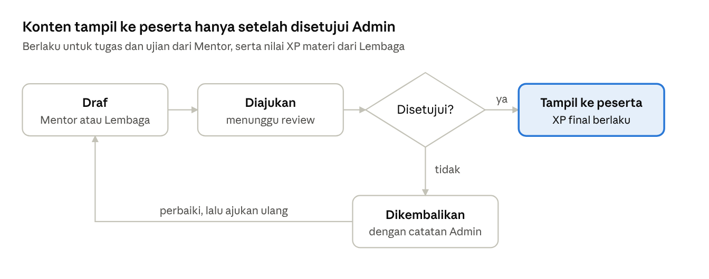
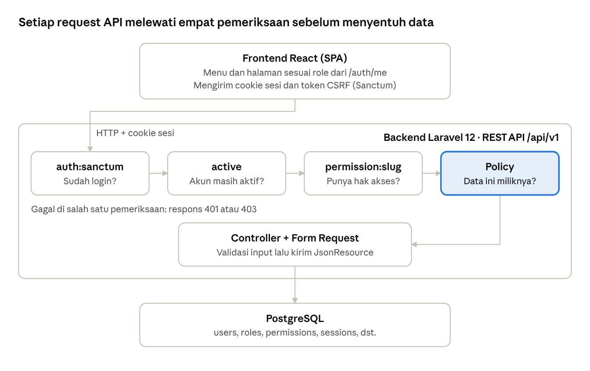

# Tujuan dan Kegunaan Sistem LMS Maxy Academy

Diperbarui: 27 Oktober 2026

> Salinan dari dokumen Claude Docs "Tujuan dan Kegunaan Sistem LMS Maxy Academy". Jika salah satu versi diubah, samakan versi lainnya.

## Tentang dokumen

Dokumen ini adalah acuan tunggal tentang **untuk apa** LMS Maxy Academy dibangun, **siapa** penggunanya, dan **aturan bisnis** yang sudah disepakati. Tujuannya agar pengembangan berikutnya tidak menebak ulang aturan yang sudah diputuskan.

- **Pembaca:** pengembang backend dan frontend, anggota tim capstone, dan penguji.
- **Sumber:** laporan Capstone "Implementasi LMS Multi Segmen Berbasis Web di Maxy Academy", rangkuman alur kerja antar-role, dan keputusan pemilik proyek per 27 Oktober 2026.
- **Cara memakai:** baca bagian Tujuan sistem sampai Alur lintas-role untuk memahami sistem. Bagian Aturan bisnis yang sudah diputuskan wajib diikuti saat menulis kode.
- **Cara memperbarui:** setiap keputusan bisnis baru dicatat sebagai baris baru di tabel aturan bisnis. Hal yang belum diputuskan masuk ke bagian Hal yang belum ditentukan, bukan langsung diputuskan di kode.

## Tujuan sistem

LMS Maxy Academy menyatukan tiga segmen pembelajaran dalam satu platform web: **pendidikan akademik untuk Siswa**, **pelatihan kompetensi untuk Karyawan**, dan **program berbayar milik Lembaga Bimbingan mitra**. Tanpa sistem ini, ketiga segmen dikelola terpisah dan Maxy Academy sulit memantau akses, progres, dan pemasukan.

Sasaran sistem:

1. **Satu pintu akses** dengan lima role. Setiap role hanya melihat menu dan data sesuai kewenangannya, dan aturan ini divalidasi di backend.
2. **Pembelajaran terkelola dari awal sampai akhir:** materi, sesi online, tugas, ujian, penilaian, dan feedback berada di satu tempat.
3. **Mutu konten terjaga:** setiap tugas dan ujian dari Mentor wajib direview Admin sebelum sampai ke peserta.
4. **Progres terukur:** penyelesaian materi, kehadiran sesi, dan nilai tercatat otomatis. Data ini menjadi dasar laporan, XP, dan sertifikat.
5. **Motivasi belajar Siswa** melalui XP dan papan peringkat.
6. **Pengakuan kompetensi Karyawan** melalui sertifikat yang diterbitkan Admin setelah syarat nilai dan kehadiran terpenuhi.
7. **Kemitraan dengan Lembaga Bimbingan:** lembaga menjual programnya sendiri kepada Siswa, sementara Admin tetap memantau aktivitas dan pemasukan kerja sama.

## Kegunaan sistem

Setiap pihak memakai sistem untuk kebutuhan yang berbeda:

| Pihak | Kegunaan utama |
| --- | --- |
| Maxy Academy (Admin) | Mengelola semua akun dan hak akses, menjaga mutu tugas, ujian, dan XP lewat review, menerbitkan sertifikat, serta memantau aktivitas dan pemasukan dari satu dashboard |
| Mentor | Menyusun kursus, sesi, tugas, dan ujian, menilai hasil pengerjaan, memberi feedback, dan memantau progres peserta yang diampu |
| Siswa | Belajar di kursus akademik dan program Lembaga, mengerjakan tugas dan ujian, melihat nilai dan feedback, serta mengumpulkan XP |
| Karyawan | Mengikuti pelatihan dan webinar, mengerjakan evaluasi, melihat riwayat belajar, lalu mengajukan sertifikat |
| Lembaga Bimbingan | Menjual dan mengelola program sendiri, melihat siswa yang membeli program, memantau progres mereka, serta melihat enrollment dan pemasukan |

## Lima role dan batas aksesnya

Setiap akun memiliki tepat satu role, dan semua akun dibuat oleh Admin. Tidak ada pendaftaran mandiri, termasuk untuk Karyawan.

| Role | Tanggung jawab | Menu utama | Batas akses data |
| --- | --- | --- | --- |
| Admin | Pengelola sistem: akun, role, kursus, review tugas/ujian/XP, sertifikat, kupon, gamifikasi, monitoring pemasukan | Dashboard, Manajemen User, Manajemen Kursus, Review, Sertifikat, Kupon, Gamifikasi, Lembaga Bimbingan, Pengaturan | Semua data |
| Mentor | Pengajar kursus akademik, pelatihan, dan webinar | Ringkasan, Kursus Saya, Peserta, Tugas & Ujian, Penilaian, Jadwal, Diskusi, Notifikasi, Profil | Hanya kursus yang ia ampu (satu kursus satu Mentor) dan peserta di kursus itu |
| Siswa | Peserta kursus akademik dan program Lembaga | Ringkasan, Kursus Saya, Katalog Program, Tugas, Jadwal, Laporan, Papan Peringkat, Pembayaran, Notifikasi, Profil | Hanya kursus yang ia ikuti (enrollment aktif) dan data dirinya |
| Karyawan | Peserta pelatihan dan webinar | Ringkasan, Pelatihan, Webinar, Tugas & Evaluasi, Sertifikat, Laporan, Pembayaran (simulasi), Notifikasi, Profil | Hanya pelatihan/webinar yang ia ikuti dan data dirinya |
| Lembaga Bimbingan | Mitra yang menjual program sendiri (1 akun = 1 lembaga) | Ringkasan, Kelola Program, Jelajahi, Siswa, Voucher, Laporan, Profil, Pengaturan | Hanya program milik lembaganya dan siswa yang membeli program itu |

Menu di tabel ini adalah usulan target akhir yang diturunkan dari kebutuhan fungsional, dan namanya boleh berubah. Menu yang sudah ada di kode dijelaskan di bagian Kondisi implementasi saat ini.

## Jenis kursus

Sistem mengenal empat jenis kursus. Hampir semua aturan bisnis bergantung pada jenis kursus, jadi tabel ini adalah inti dari seluruh desain.

| Aspek | Akademik | Pelatihan | Webinar | Program Lembaga |
| --- | --- | --- | --- | --- |
| Pembuat | Admin atau Mentor | Admin atau Mentor | Admin atau Mentor | Lembaga |
| Pengajar | 1 Mentor | 1 Mentor | 1 Mentor | Tanpa Mentor |
| Peserta | Siswa | Karyawan | Karyawan | Siswa |
| Cara masuk | Didaftarkan Admin | Didaftarkan Admin | Didaftarkan Admin | Siswa membeli sendiri dari katalog |
| Pembayaran | Tidak ada | Simulasi (tahap awal) | Simulasi (tahap awal) | Simulasi, nanti payment gateway |
| Isi | Materi, sesi, tugas, ujian | Materi, sesi, tugas, ujian | Materi, sesi, tugas, ujian | Materi dan sesi saja |
| Review Admin | Tugas dan ujian | Tugas dan ujian | Tugas dan ujian | Nilai XP materi |
| XP | Ya | Tidak | Tidak | Ya |
| Sertifikat | Tidak | Ya | Ya | Tidak |

Catatan:

- Kursus yang dibuat Mentor otomatis diampu Mentor tersebut. Admin dapat mengganti Mentor-nya.
- Mentor tidak dapat mengajar di Program Lembaga.
- Satu Siswa boleh membeli program dari beberapa Lembaga sekaligus. "Siswa milik Lembaga" berarti Siswa yang punya enrollment di program lembaga itu. Lembaga tidak membuat atau mendaftarkan akun Siswa.

## Alur lintas-role

Ada lima alur utama. Semua alur bertumpu pada data yang sama: kursus, enrollment, progres materi, kehadiran, pengumpulan tugas, dan nilai.

### A. Pembelajaran akademik Siswa

1. Admin atau Mentor membuat kursus akademik. Admin menunjuk satu Mentor.
2. Admin mendaftarkan Siswa ke kursus.
3. Mentor menyusun materi, sesi, tugas, dan ujian, termasuk nilai XP-nya.
4. Admin mereview tugas, ujian, dan nilai XP. Hanya yang disetujui yang tampil ke Siswa.
5. Siswa membaca materi, bergabung ke sesi, mengumpulkan tugas, dan mengerjakan ujian.
6. Mentor menilai dan memberi feedback.
7. Siswa melihat nilai, feedback, laporan belajar, XP, dan papan peringkat.

### B. Program Lembaga Bimbingan

1. Lembaga membuat program berisi materi dan sesi, lalu menetapkan harga dan nilai XP materi.
2. Admin menyetujui nilai XP, dan boleh mengubahnya.
3. Program tampil di katalog Siswa.
4. Siswa membeli program dan menekan "Bayar (simulasi)". Enrollment langsung aktif.
5. Siswa membaca materi dan bergabung ke sesi.
6. Lembaga melihat daftar siswa, progres, jumlah enrollment, dan pemasukan.
7. Admin memantau pemasukan kerja sama dari semua Lembaga.

### C. Pelatihan Karyawan dan sertifikasi

1. Admin atau Mentor membuat pelatihan atau webinar. Admin mendaftarkan Karyawan.
2. Mentor menyusun materi, sesi, tugas, dan ujian. Admin mereview tugas dan ujian.
3. Karyawan belajar, bergabung ke sesi, serta mengerjakan tugas dan ujian. Mentor menilai.
4. Karyawan mengajukan sertifikat.
5. Sistem memeriksa syarat: nilai tugas dan ujian memenuhi batas minimum, dan kehadiran memenuhi batas minimum.
6. Admin mereview pengajuan secara manual, lalu menerbitkan sertifikat atau menolaknya dengan alasan.

### D. Review konten oleh Admin

Berlaku untuk tugas dan ujian buatan Mentor, serta nilai XP materi buatan Lembaga.

Saat menyetujui, Admin boleh mengubah nilai XP. Konten yang dikembalikan diperbaiki pembuatnya, lalu diajukan ulang.

### E. Sesi dan kehadiran

1. Tombol "Gabung sesi" aktif mulai 15 menit sebelum sesi dimulai sampai sesi selesai. Di luar rentang itu tombol nonaktif.
2. Saat peserta menekan tombol, sistem mencatat kehadiran lalu mengarahkan peserta ke link meeting.
3. Persentase kehadiran per kursus dihitung dari catatan ini dan dipakai untuk syarat sertifikat serta laporan progres.

## Aturan bisnis yang sudah diputuskan

Semua keputusan di bawah ditetapkan pemilik proyek pada 27 Oktober 2026. Aturan ini wajib diikuti di kode. Perubahan aturan dicatat sebagai baris baru beserta tanggalnya.

| Topik | Keputusan |
| --- | --- |
| Akun | Semua akun, termasuk Karyawan, dibuat Admin. Tidak ada pendaftaran mandiri. |
| Lembaga | Satu akun Lembaga mewakili satu lembaga. |
| Pembuat kursus | Kursus akademik, pelatihan, dan webinar dibuat Admin atau Mentor. Program Lembaga dibuat Lembaga. |
| Penugasan Mentor | Satu kursus diampu satu Mentor. Mentor tidak mengajar di program Lembaga. |
| Enrollment | Siswa (akademik) dan Karyawan (pelatihan/webinar) didaftarkan Admin. Program Lembaga dibeli sendiri oleh Siswa dari dashboard. |
| Siswa dan Lembaga | Lembaga menerima data Siswa yang membeli programnya. Satu Siswa boleh ikut beberapa Lembaga. |
| Isi program Lembaga | Hanya materi (dan sesi), tanpa tugas dan ujian. |
| Pembayaran | Dikerjakan di tahap akhir. Sementara ini hanya tampilan dengan tombol "Bayar (simulasi)". Menu Pembayaran Karyawan tetap ada dengan simulasi. |
| Pemasukan kerja sama | Dikerjakan di tahap akhir bersama pembayaran. |
| Review Admin | Semua tugas dan semua ujian wajib direview Admin sebelum tampil ke peserta. |
| XP: penerima | Hanya Siswa. |
| XP: pengatur | Mentor dan Admin mengatur XP materi, tugas, dan ujian. Untuk program Lembaga, Lembaga mengusulkan XP materi, Admin menyetujui dan boleh mengubahnya. |
| XP: kapan diberikan | Materi: saat selesai dibaca. Tugas: saat dikumpulkan. |
| Kehadiran | Tercatat otomatis saat peserta menekan "Gabung sesi". Tombol aktif 15 menit sebelum sesi sampai sesi selesai. |
| Sertifikat | Untuk Karyawan. Syarat: nilai tugas dan ujian memenuhi batas minimum serta kehadiran memenuhi batas minimum. Admin lalu mereview dan menyetujui secara manual. |
| Kupon dan voucher | Arah sementara, masih perlu konfirmasi: kupon Admin dan voucher Lembaga adalah dua fitur terpisah (usulan teknis: satu tabel dengan kolom pemilik, menu dan hak akses terpisah). |

## Kondisi implementasi saat ini

Per 27 Oktober 2026, yang sudah dibangun baru **fondasi**: login, RBAC lima role, manajemen user oleh Admin, dan dashboard dasar. Semua modul bisnis (kursus, tugas, ujian, XP, sertifikat, pembayaran, voucher, notifikasi) belum ada.

Policy adalah tempat aturan seperti "Mentor hanya kursusnya" dan "Lembaga hanya programnya" diterapkan. Tidak semua route memakai keempat pemeriksaan: permission dan Policy dipasang sesuai kebutuhan endpoint.

| Bagian | Teknologi dan lokasi |
| --- | --- |
| Repositori | Monorepo `lms-capstone` berisi `backend/` dan `frontend/` |
| Backend | Laravel 12, PHP 8.2, REST API dengan prefix `/api/v1` |
| Autentikasi | Laravel Sanctum mode SPA (cookie sesi dan CSRF), bukan token |
| Database | PostgreSQL untuk development. Test memakai SQLite in-memory |
| Frontend | React 18, TypeScript, Vite, React Router, Axios, Tailwind CSS |
| CI | GitHub Actions untuk test backend dan build frontend |

**Yang sudah tersedia:**

- Endpoint `health`, `auth/login`, `auth/logout`, `auth/me`, CRUD `users` (khusus Admin), `roles`, dan `admin/summary`.
- Tabel `users` (dengan status `active`, `inactive`, `suspended`), `roles`, `permissions`, `role_user`, `permission_role`, dan `sessions`.
- Perintah `php artisan lms:create-admin` untuk membuat Admin pertama tanpa password default di kode.
- Frontend: login, dashboard per role, layout sidebar untuk Admin dan navigasi atas untuk role lain, daftar user (baca saja), dan profil (baca saja).

**Cara kerja kode yang perlu diikuti:**

- Otorisasi dua lapis. Middleware `permission:<slug>` memeriksa hak akses umum. Policy (contoh `UserPolicy`) memeriksa akses per data.
- Daftar permission dan pemetaannya ke role ada di `RolePermissionSeeder` (`PERMISSIONS` dan `MATRIX`).
- Menu frontend dibaca dari `frontend/src/config/navigation.ts` dan otomatis menjadi route. Menu yang belum punya halaman memakai halaman placeholder.

## Prinsip dan konvensi pengembangan

**Prinsip:**

1. **Backend adalah sumber kebenaran hak akses.** Menyembunyikan menu di frontend hanya untuk kenyamanan. Batas "Mentor hanya kursusnya" dan "Lembaga hanya programnya" wajib diperiksa di Policy.
2. **Least privilege.** Role hanya mendapat permission yang benar-benar dipakai. Setiap permission baru ditambahkan ke `RolePermissionSeeder` beserta test-nya.
3. **Relasi data yang jelas** untuk setiap alur: pemilik kursus, enrollment, penugasan Mentor, pengumpulan tugas, nilai, kehadiran, XP, dan sertifikat.
4. **Bertahap.** Fondasi dulu, lalu kursus dan konten, tugas dan ujian, program Lembaga, sertifikat, gamifikasi, laporan, dan terakhir pembayaran nyata.
5. **Jangan membuat aturan bisnis sepihak.** Detail yang tidak ada di dokumen ini dicatat sebagai pertanyaan terbuka, bukan diputuskan langsung di kode.
6. **Bedakan yang dirancang dan yang jadi.** Fitur yang belum selesai tampil sebagai "belum tersedia", bukan dengan data palsu.

**Konvensi teknis:**

- Migration harus berjalan di PostgreSQL dan SQLite. Status disimpan sebagai string dan divalidasi dengan `Rule::in`, bukan enum database. Hindari SQL khusus Postgres.
- Nama tabel `sessions` sudah dipakai Laravel untuk sesi login. Tabel sesi belajar memakai nama lain, misalnya `class_sessions`.
- Data yang punya riwayat (user, kursus, nilai, sertifikat) sebaiknya memakai soft delete atau status nonaktif agar riwayat tidak hilang.
- Pesan validasi dan error dalam Bahasa Indonesia. Response memakai `JsonResource` dengan tambahan `message`.
- Setiap fitur baru disertai feature test, termasuk test bahwa role lain ditolak (403).

## Tahapan pengembangan

Urutan ini disusun agar setiap tahap hanya bergantung pada tahap sebelumnya. Rencana rinci tiap tahap (tabel, endpoint, permission, test) disetujui pemilik proyek sebelum kode ditulis.

1. **Melengkapi fondasi**
   - Ubah profil dan ganti password sendiri untuk semua role.
   - Notifikasi, soft delete user, dan export daftar user.
   - Form tambah dan ubah user di frontend.
   - Profil lembaga dibuat bersamaan dengan akun Lembaga.
2. **Kursus, konten, dan enrollment**
   - Empat jenis kursus, modul, materi, dan sesi.
   - Penugasan Mentor dan pendaftaran peserta oleh Admin.
   - Progres materi, tombol "Gabung sesi", dan pencatatan kehadiran.
3. **Tugas, ujian, review, dan penilaian**
   - Tugas, ujian, dan soal buatan Mentor.
   - Review Admin, pengumpulan oleh peserta, nilai, dan feedback.
4. **Program Lembaga**
   - Katalog untuk Siswa, beli program dengan "Bayar (simulasi)".
   - Usulan XP materi oleh Lembaga dan persetujuan Admin.
   - Dashboard Lembaga: siswa, progres, enrollment.
5. **Gamifikasi:** pencatatan XP Siswa dan papan peringkat.
6. **Sertifikat Karyawan:** pemeriksaan syarat, pengajuan, review Admin, dan penerbitan.
7. **Laporan dan dashboard** per role dengan data nyata.
8. **Pembayaran nyata dan voucher:** payment gateway, kupon Admin, voucher Lembaga, dan laporan pemasukan kerja sama.

## Hal yang belum ditentukan

Pertanyaan ini perlu dijawab sebelum tahap terkait dikerjakan. Setelah dijawab, pindahkan jawabannya ke tabel aturan bisnis.

- [ ] **XP ujian:** diberikan saat ujian dikumpulkan seperti tugas, atau setelah dinilai? (tahap 3)
- [ ] **Angka syarat sertifikat:** berapa nilai minimum dan persentase kehadiran minimum? Diatur per kursus atau berlaku global? Siapa yang mengaturnya? (tahap 6)
- [ ] **Cara menghitung nilai sertifikat:** rata-rata semua tugas dan ujian, atau setiap tugas dan ujian harus lulus? (tahap 6)
- [ ] **Pembayaran Karyawan:** Karyawan didaftarkan Admin, jadi tagihan apa yang dibayar lewat menu Pembayaran? (tahap 2 untuk tampilan)
- [ ] **Program Lembaga tanpa XP disetujui:** boleh tampil di katalog dengan XP 0 sambil menunggu review Admin? (tahap 4)
- [ ] **Kupon dan voucher:** konfirmasi bahwa keduanya fitur terpisah. (tahap 8)
- [ ] **Diskusi dan rating:** cakupan forum diskusi (Mentor dengan Karyawan, Lembaga dengan Siswa) dan siapa yang melihat rating materi dari Siswa.
- [ ] **Bagi hasil Admin dan Lembaga:** ada potongan atau hanya pemantauan angka? (tahap 8)
- [ ] **Bentuk sertifikat:** file PDF bernomor, masa berlaku, dan cara verifikasi. (tahap 6)
